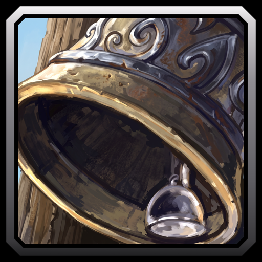

# Remind Me Later

A WoW Forever addon that reminds you of anything by countdown, time of day or zone. Reminders arrive as a whisper, a chat line or a raid warning, and only you see them.

## Features

- Countdown reminders, once or repeating.
- Time of day reminders on realm or local time, once, daily or weekly.
- Zone reminders when you enter a zone or an area in it.
- A whisper, a chat line or a raid warning across the screen.
- The minimap button shows your next five reminders.
- Reminders work on every character, and a one-time reminder you missed fires at login.

## Usage

1. Type `/rm` or click the minimap button.
2. Type your message, pick Countdown, Time of Day or Zone, and fill in the field below.
3. Under Send As, pick Whisper, Chat or Raid Warning. Test shows how it arrives.
4. Press Add Reminder. It joins the list on the left.
5. Click a reminder in the list to change it, then press Save. Delete removes it, and New Reminder starts a fresh one.

Commands:

- `/rm in 1h 30m Check the auction house`
- `/rm at 20:30 Raid tonight`
- `/rm zone Stormwind City: Buy reagents`, or `/rm here <text>` for the zone you are in.
- `/rm list`, `/rm edit 2`, `/rm remove 2` and `/rm clear` manage your reminders.
